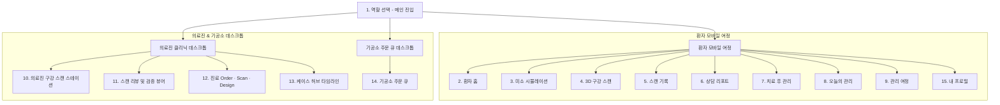

> **출처**: 사용자가 2026-10-21 채팅으로 제공한 PRD 원문 (Stitch 프로젝트 대응 문서로 추정). 아래는 원문 그대로이며, 2026-10-21 참고 문서로 패키지에 편입했다. 제품 요구사항의 정본은 `미리미소-PRD.md`이고, 본 제공본과 충돌하면 정본과 기존 명세(비진단·미검증 수치 표기 원칙)가 우선한다.
> ⚠️ **표기 주의 (기존 원칙 유지)**: §5·§7의 수치(스캔 시간 7.5→2.5분, 재스캔율 14.2%→2.0%, 리메이크 8.5%→1.2%, 마진 42μm, 계측 일치율 99.4%, 완주율 82% 등)와 "AI 종합 소견·PASS/FAIL 판정·자동 계측" 표현은 **목표/주장이며 실측·검증된 결과가 아니다**. 앱·제안 문서에 사실처럼 표기하지 않으며, 판정·계측 류는 비진단 참고 원칙(규제전략 Phase B 분리)을 따른다.

---

# [PRD] 미리미소 (MiriMiso) — AI·3D 기반 차세대 스마트 치과 임상 & 환자 케어 솔루션

---

## 1. 프로젝트 개요 (Executive Summary)

### 1.1 프로젝트 정의
**미리미소(MiriMiso)**는 체어사이드(Chairside) 3D 구강 스캐너 하드웨어 및 클라우드 AI 엔진과 연동되어, **환자(Patient) — 의료진(Clinic) — 기공소(Lab)** 3자 간의 진료·스캔·보철 제작·치료 후 회복 여정을 끊김 없이 연결하는 차세대 디지털 덴티스트리 통합 플랫폼입니다.

### 1.2 핵심 문제 정의 (Pain Points)
- **환자 관점**: 임플란트 및 보철 치료 과정에 대한 불안감, 복잡한 치과 전문 용어에 대한 이해 부족, 수술 후(3일~30일) 체계적인 자가 관리 가이드 및 비상 연락 체계 부재.
- **의료진 관점**: 3D 구강 스캔 시 스캔 팁 각도 누락이나 결손 홀(Hole)로 인한 잦은 재스캔, 교합 간섭 및 마진 라인 오차 판정 지연, 수기 차팅 및 기공 지시서 작성에 따른 비효율.
- **기공소 관점**: 병원에서 넘어오는 STL/PLY 3D 데이터의 품질 편차, 잦은 리메이크(Remake), 실시간 밀링기 가동 현황 파악 불가 및 배송 지연.

### 1.3 솔루션 비전 & 핵심 가치
- **3초 코칭 HUD & REA 분석**: 실시간 스캔 스트림을 분석하여 팁 각도 및 누락 영역을 3초 안에 가이드하여 원테이크 스캔 달성.
- **원클릭 CAD & 기공 연동**: 32개 FDI 치식 기반 마진 적합도(42μm) 자동 계측 및 기공소 CAM 전송 자동화.
- **30일 맞춤형 환자 여정 캘린더**: AI 구강 셀프 치태 분석, 복약 알림, 잔디 캘린더를 통한 환자 순응도(Compliance) 극대화.

---

## 2. 사용자 페르소나 및 역할 정의 (User Roles & Personas)

| 역할 (Role) | 주요 사용자 | 핵심 목표 | 주요 인터랙션 환경 |
| :--- | :--- | :--- | :--- |
| **환자 (Patient)** | 만 20~60대 치과 내원 환자 (임플란트/심미/교정) | 시술 전후 시뮬레이션 확인, 치료 후 통증/출혈 관리, 내원 일정 확인 | 모바일 웹 / 반응형 앱 (iOS/Android) |
| **의료진 (Clinic)** | 치과의사, 치과위생사 | 체어사이드 고정밀 3D 스캔, 자동 품질 판정(PASS/FAIL), CAD Order 발행 | 데스크톱 와이드 웹 / 전용 터치 체어사이드 PC |
| **기공소 (Lab)** | 치과기공소 관리자 및 기공사 | 3D 지오메트리 무결성 검증, 5축 밀링 장비 툴패스 분배, 납기 관리 | 데스크톱 와이드 모니터 / 기공실 전용 워크스테이션 |

---

## 3. 디자인 시스템 규격 (MiriMiso Clinical Clean)

- **디자인 컨셉**: 임상적 전문성(Clinical Precision)과 환자 친화적 청결감(Clean & Trustworthy)
- **Primary Color**: `#27AE8D` (딥 에메랄드 민트 - 치과적 안정과 신뢰)
- **Secondary Color**: `#17BEBB` (사이언 터콰이즈 - 첨단 3D 디지털 기술감)
- **Light Theme**: 배경 `#F4F6F9`, 표면 `#FFFFFF`, 텍스트 `#1F2937`
- **Dark Theme**: 배경 `#0D1520`, 카드 표면 `#172435`, 텍스트 `#E9F1F8`
- **타이포그래피**: Noto Sans KR (가독성 최우선, 계측 수치용 모노스페이스 병행)
- **라운드 & 컴포넌트**: `12px~16px` 소프트 라운드 코너, 8px 그리드 시스템 준수

---

## 4. 정보 구조도 (Information Architecture & Screen Matrix)

총 15개 핵심 프로덕션 화면으로 구성되며, 각 화면의 역할과 UI/UX 컴포넌트는 완벽히 분리되어 있습니다.



---

## 5. 화면별 상세 기능 요구사항 (Functional Specifications)

### [Part 1] 환자 모바일 여정 (Screens 1~9, 15)

#### 1. 역할 선택 (메인 진입) — `SCREEN_31`
- **기능**: 환자/의료진/기공소 3대 진입 경로 분기 카드, 직관적 온보딩 브랜딩.
- **UI 컴포넌트**: 브랜드 로고마크, 3단 퀵 액세스 선택 카드, 보안 로그인 및 간편 본인인증.

#### 2. 환자 홈 — `SCREEN_29`
- **기능**: 당일 케어 현황 요약, 담당 주치의 배정 및 다음 내원 D-day 알림, 2열 퀵 내비게이션 그리드.
- **핵심 지표**: 플라크 관리 지수(18%), 다음 예약일시(2026.10.28), 담당 주치의 직통 버튼.

#### 3. 미소 시뮬레이션 — `SCREEN_27`
- **기능**: 정면 구강 사진 업로드, 시술 유형별(라미네이트, 투명교정, 미백, 임플란트) 3D 인터랙티브 전·후(Before/After) 비교 슬라이더.
- **UI 컴포넌트**: 스플릿 슬라이더 컨트롤러, 시술 예상 기간 및 비용 추정 가이드.

#### 4. 3D 구강 스캔 — `SCREEN_12`
- **기능**: 상악/하악 인터랙티브 3D 치아 아치 뷰어, FDI 치아별 스캔 품질 모니터링(완료/보강 필요), 4단계 주행 가이드.
- **UI 컴포넌트**: 3D 회전 제어기, 스캔 완성도 게이지(94%), 결손 부위 하이라이트.

#### 5. 스캔 기록 — `SCREEN_10`
- **기능**: 1회차부터 4회차까지의 플라크 지수 개선 추이(34% → 18%) 라인 차트, 회차별 3D 메쉬 썸네일 및 PLY 파일 내보내기.
- **핵심 지표**: 누적 스캔 수(4회), 평균 오차율(14μm), 주치의 코칭 메시지 히스토리.

#### 6. 상담 리포트 — `SCREEN_25`
- **기능**: 4분면 치아 건강 종합 분석(충치, 마모, 치주염, 크랙), AI 종합 소견 요약, 환자 맞춤형 치료 플랜 비교표.
- **UI 컴포넌트**: PDF 원클릭 저장, 가족 및 의료진 메신저 공유 CTA.

#### 7. 치료 후 관리 — `SCREEN_6`
- **기능**: `#16 상악 제1대구치` 임플란트 수술 3일차 안심 케어, 자가 증상(통증/붓기/출혈/복약) 4대 세그먼트 체크, 냉찜질·식사 수칙 체크리스트.
- **응급 안전망**: 38℃ 이상 고열/지속 출혈 시 `스마일치과 당직 핫라인 (02-555-1234)` 원터치 긴급 다이얼.

#### 8. 오늘의 관리 — `SCREEN_8`
- **기능**: 일일 구강 상태 퀵 체크(통증, 붓기, 출혈, 저작감, 사용 도구), 스마트폰 카메라 기반 AI 플라크 셀프 촬영 분석(30초), 데일리 60자 메모.
- **게이미피케이션**: 14일 연속 기록 배지, 이번 주 기록 6/7회 달성도.

#### 9. 관리 여정 — `SCREEN_4`
- **기능**: 30일 회복 잔디 캘린더 히트맵, 4단계 수술 마일스톤(1단계: 지혈 → 2단계: 실밥제거 → 3단계: 골유착 안정화 → 4단계: 지르코니아 보철 장착).
- **리포팅**: 이번 주 실천 스코어 94점, 주간 플라크 침착도(18%) 및 대표원장 주간 코칭 소견서 발급.

#### 15. 내 프로필 — `SCREEN_2`
- **기능**: 스마트 케어 알림 토글(치주 복약, 구강 셀프 체크, 예약 D-1 알림), 다크/라이트 모드 테마 스위치, 글자 크기 조절, 3D 메쉬 캐시 정리(38.2MB), HL7/FHIR 국제 표준 호환 STL/PLY 패키지 ZIP 다운로드.

---

### [Part 2] 의료진 & 기공소 데스크톱 웹 (Screens 10~14)

#### 10. 의료진 구강 스캔 스테이션 — `SCREEN_23`
- **기능**: 체어사이드 고속 3D 스트리밍, 45도 스캔 팁 각도 벡터 보강 HUD, 결손 홀(Hole) 실시간 붉은색 감지 알림.
- **시퀀스**: 전치부 설측 → 교합면 → 협측 4단계 가이드 바 및 하드웨어(TRIOS/Medit) 연동 상태 표시.

#### 11. 스캔 리뷰 및 검증 뷰어 — `SCREEN_21`
- **기능**: 마진 적합도(Margin Line, 42μm 오차 정밀 계측), 3D 대합치 교합 간섭 히트맵(-0.15~+0.20mm), 언더컷 2개소 자동 감지.
- **품질 판정**: 3D 지오메트리 최종 합격(PASS) 판정 및 기공소 즉시 전송 버튼.

#### 12. 진료 Order · Scan · Design — `SCREEN_18`
- **기능**: FDI 32개 전악 치식 차트에서 치료 치아(#16) 원클릭 지정, 보철물 종류(지르코니아/E.max/인레이), 셰이드(VITA Classical A1~C3) 선택, AI Auto CAD 파라미터(시멘트 갭 30μm, 마진 두께 0.2mm) 설정.

#### 13. 케이스 허브 타임라인 — `SCREEN_16`
- **기능**: 7단계 상태 머신(스캔 완료 → 진단 수립 → 동의 서명 → 기공 의뢰 → 밀링 제작 → 체어 세팅 → 예후 관찰) 파이프라인.
- **위기 관리**: 당일 긴급 케이스 우선순위 큐(Queue) 및 기공소 배송 추적 연동.

#### 14. 기공소 주문 큐 — `SCREEN_14`
- **기능**: 5축 초고속 치과 밀링 장비 3대 실시간 가동율 및 잔여 시간 모니터링, REA 3D 지오메트리 자동 호환성 검증(STL/PLY), CAM 툴패스 코드 원클릭 발송.

---

## 6. 기술 아키텍처 및 데이터 연동 규격 (Technical Architecture)

```text
[Hardware Layer] 
  - TRIOS / Medit / iTero 구강 스캐너 (USB 3.0 / 광학 인터페이스)
  - 5축 치과 밀링 머신 (CAM Controller / NC Code)

[Edge / Local Software (Electron & WebGL)]
  - Three.js / WebGL 2.0 기반 초당 60fps 3D 메쉬 렌더러
  - OpenCV 기반 실시간 팁 각도 추적 및 결손 홀(Hole Filling) 연산
  - 로컬 캐시 관리자 (IndexedDB / Indexed Mesh Storage)

[Cloud AI & Integration Layer]
  - 3D Mesh Inspection Engine (마진 적합도, 교합 클리어런스 연산)
  - HL7 / FHIR v4.0 준수 EMR(전자의무기록) 인터페이스
  - DICOM / STL / PLY / OBJ 바이너리 파이프라인

[Client Presentation Layer]
  - Patient App: PWA (Mobile Web & React/Tailwind)
  - Clinic/Lab Web: High-Density Desktop Web Dashboard (Tailwind CSS)
```

---

## 7. 성공 지표 (KPIs & Metrics)

1. **임상 효율성**:
   - 체어사이드 평균 구강 스캔 시간: ** 기존 7.5분 → 2.5분 이내 단축 (66% 개선)**
   - 스캔 불량에 의한 재스캔율: **기존 14.2% → 2.0% 이하 달성**
2. **보철물 정밀도**:
   - 기공소 리메이크(재제작) 비율: **기존 8.5% → 1.2% 미만 억제**
   - 마진 적합도 계측 일치율: **99.4% 신뢰도 달성**
3. **환자 경험 및 순응도**:
   - 수술 후 30일 일일 관리 체크리스트 완주율: **82% 이상**
   - 시술 만족도 및 모바일 리포트 환자 공유율: **75% 달성**

---

## 8. 릴리즈 로드맵 (Milestones & Roadmap)

- **Phase 1 (완료)**: 15개 핵심 전악 화면 UX/UI 설계 및 프로토타입 캔버스 구축 완료.
- **Phase 2 (현재)**: 3D WebGL 메쉬 뷰어 인터랙션 고도화 및 다크 모드 듀얼 테마 지원.
- **Phase 3**: 원내 EMR(오스템 OneClick, 덴트웹) 연동 플러그인 개발 및 기공소 CAM 드라이버 연계.
- **Phase 4**: 식약처(MFDS) 및 FDA SaMD(의료기기 소프트웨어) 2등급 임상 인허가 획득.
